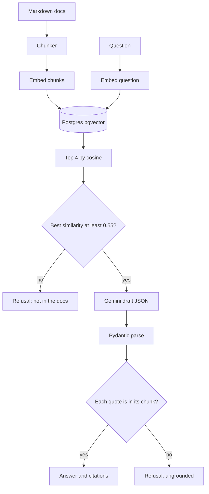

# RAG plan for PCB defect notes

This file is the v1 plan. It adds no application code. Later work lands as five PRs, in order. Each waits for the one before it. None of them branch from trunk in parallel. Each waits for your review before merge.

## Goal

You are building a question-answering service over PCB defect notes and a rework SOP you write yourself. The notes cover the six DeepPCB-AOI classes: open, short, mousebite, spur, copper, and pin-hole. Copper means spurious copper. The service chunks the notes, embeds them, stores them in Postgres with pgvector, and returns an answer only when each sentence has a verbatim quote from a retrieved chunk. If nothing relevant is retrieved, the answer is "not in the docs".

In an interview, walk one question from the markdown file to the SQL query to the quote check. DeepPCB-AOI finds a defect box on an image. This repo never sees the image. It only answers from documents, and it can show the quote. Point at `eval/run_eval.py` for recall@4, citation correctness, and the refusal rate on questions the docs cannot answer.

Out of scope for v1: LangGraph, a multi-tool agent, a cloud deploy, a UI, and any call to the DeepPCB-AOI API. Budget about one to two weeks.

## How we work

These rules come from Lauren Tan's pstack style. Each one changes a concrete choice in this repo.

**Foundational thinking.** Name the data shape before any logic. M1 adds `src/types.py` with the types in the next section. Later files take those types and do not invent new dicts.

**Laziness protocol.** Build the smallest thing that works. v1 is plain Python and SQL. No LangChain and no LangGraph. Allowed packages are fastapi, uvicorn, pydantic, httpx, psycopg with the binary extra, and pytest. A package that is not on this list does not get added. httpx calls the Gemini REST API, so you do not add a Google SDK.

**Sequence verifiable units.** M1 through M5 each end in a check you can rerun. Do not start the next milestone while that check is red.

**Build the lever.** `eval/run_eval.py` is the tool that proves a change. From M3 on, every PR includes the script output from before the change and after it. Do not judge a retrieval change from one chat reply.

**Explain the number.** When recall@4 changes, the script lists the case ids that flipped. Write why those cases flipped before you trust the new number. One case in a set of 15 is about 0.07. Rerun once. Retrieval over stored vectors should stay put across reruns. Generation metrics can move.

**Test behavior, not implementation.** Tests send `POST /ask` and assert the JSON. They check citations, verbatim quotes, and refusals. They do not assert private helper order.

**Boundary discipline.** Gemini JSON is untrusted. Pydantic parses it at the boundary of `ask`. A pure function then checks quotes against chunk text. That function does not import FastAPI.

**Unslop.** README text, PR text, and commit text stay plain. Use words you would say out loud. If you cannot explain a sentence in the interview, rewrite it.

## Core types

`GroundedAnswer` and `Refusal` are different types. A refusal cannot carry citations. A grounded answer has at least one sentence.

```text
Doc: doc_id, path, title, text
Chunk: chunk_id, doc_id, doc_name, section_path, page, chunk_index, char_span, text
Citation: chunk_id, quote
Sentence: text, citation
GroundedAnswer: sentences
Refusal: reason, text
EvalCase: case_id, question, answerable, expected_chunk_ids, reference_answer
```

`reason` is `not_in_docs` or `ungrounded`. `Refusal.text` is always "not in the docs". `doc_id` and `chunk_id` are different strings. A chunk id looks like `open#0`. `doc_name` is the document title. `section_path` is a list of headings. `page` is null for markdown. `char_span` is the start and end of the body in the document text. `text` is the contextual header, a blank line, then the body. An unanswerable `EvalCase` has an empty `expected_chunk_ids` list. The HTTP body is flat: `answer`, `citations` as `{chunk_id, quote}` in sentence order, and `reason` of `ok`, `not_in_docs`, or `ungrounded`.

## Architecture



```text
docs/PLAN.md
requirements.txt
docs/corpus/*.md
src/__init__.py
src/types.py
src/config.py
src/chunk.py
src/embed.py
src/store.py
src/retrieve.py
src/ground.py
src/ask.py
src/api.py
sql/chunks.sql
data/chunks.jsonl
eval/cases.jsonl
eval/run_eval.py
eval/last.json
tests/test_chunk.py
tests/test_ask.py
.github/workflows/eval.yml
```

`docs/corpus` is the source of truth. Commit `data/chunks.jsonl` and `eval/last.json` so a PR shows the text and the cases that moved. `.env` stays untracked.

## Design decisions

### Chunk size and overlap

**Chosen.** Split each file on H1, H2, and H3. Keep numbered steps together. If a section body is at most 2000 characters, it stays one chunk. If it is longer, cut windows of 2000 characters with 200 characters of overlap, on a paragraph or sentence boundary when one exists. 2000 characters is about 500 tokens. 200 is about 50 tokens. The assumption is `CHARS_PER_TOKEN = 4` in `src/config.py`. A short section stays one chunk. Two short sections stay two chunks.

Every chunk stores `doc_name`, `section_path`, `page` (`None` for markdown), `chunk_index`, and `char_span`. The embedded text starts with a contextual header such as `波峰焊 SOP > 4.3 温度`.

**Why.** A citation should point at one fact, and each heading is one topic. One vector for a whole file mixes those topics, so retrieval gets less precise. 500 tokens is a middle size. A much larger window dilutes the embedding. A much smaller window drops the step around the fact. Overlap of about 10 percent keeps a sentence that sits on a cut. The header puts the title and the section back on a short chunk. You count characters, so v1 takes no tokenizer package.

**Alternatives.** Fixed windows with no headings can start in the middle of a step. Semantic splits cut where two sentence embeddings diverge. They add API calls and a second knob. Headings already mark the topics in this short corpus. An earlier sketch used 1600 characters and 320 of overlap. This milestone uses 2000 and 200.

### Embedding model

**Chosen.** `gemini-embedding-001` at 768 dimensions. Chunks use task type `RETRIEVAL_DOCUMENT`. Questions use `RETRIEVAL_QUERY`. L2-normalize every 768-d vector before insert and before search. A truncated `gemini-embedding-001` vector is not unit length unless you normalize it. Cosine on the raw truncated vector mixes direction with magnitude.

**Why.** You already call Gemini. One vendor covers embed and answer. 768 is the smallest size Google still recommends, so the table stays small. The chat model is `gemini-3.8-flash` at temperature 0. Both names live in `src/config.py`.

**Alternatives.** `gemini-embedding-2` at 768 normalizes truncated vectors for you, and it is the newer model. Use it only if your free tier serves it and does not serve `001`. Re-embed the whole table. Do not mix models in one table. A local `bge-small-en-v1.5` model avoids the quota and adds a heavy library. Take that path only if the free tier cannot embed the corpus and the eval set.

### Vector store

**Chosen.** Supabase Postgres with the pgvector extension. One row holds the chunk id, the doc id, the text, and the vector. Order by cosine distance, `<=>` in SQL. Similarity is `1 - distance`. Under 200 rows, scan every row. Do not add an HNSW index. The embed script deletes and reinserts the table from `data/chunks.jsonl` on every run.

**Why.** You can read the query out loud. The text and the vector stay on one row. The free tier holds this table. A full replace cannot leave a stale row after a chunker edit. If you create the project, use the Singapore region.

**Alternatives.** FAISS in a local file needs no server, and the chunk text then lives in a second file. A local Chroma file hides the SQL this project is meant to show.

### Top-k and the similarity floor

**Chosen.** Return 4 chunks. If the best cosine similarity is below 0.55, refuse with `not_in_docs` and do not call the chat model. `k` and the floor live in `src/config.py`.

**Why.** A class note plus a SOP step fits in four chunks. More chunks give the model more text to misquote. 0.55 is a starting floor, not a measured optimum. Change it only in an M3 PR that lists the cases it flips.

**Alternatives.** `k` of 1 misses a question that needs the class note and the SOP. `k` of 8 raises recall and adds noise.

### Grounding check

**Chosen.** Two gates. The retrieval gate refuses when no chunk clears the floor. The quote gate asks Gemini for JSON, one object per sentence, each with a `chunk_id` and a quote. The request sends the Pydantic JSON schema. Pydantic parses the response. A pure function accepts a quote only when, after whitespace is collapsed, it is a substring of that retrieved chunk. Case stays as written. A bad sentence, an unknown chunk id, or a quote from a different chunk rejects the whole answer. The caller sees "not in the docs" with reason `ungrounded`, and never sees the draft.

**Why.** The spec asks for a verbatim quote. The substring check is deterministic and needs no second model. The checker is the authority.

**Alternatives.** A prompt line that says to use only the context still lets the model invent a quote. An entailment model accepts paraphrases this spec rejects, and it is another model to run.

### How eval works

**Chosen.** About 20 `EvalCase` rows in `eval/cases.jsonl`. About 15 are answerable and about 5 are not. Unanswerable examples include an IPC-A-600 numeric limit, a factory cost target, and a question about a photo. `eval/run_eval.py` prints recall@4 on answerable cases and the case ids that flipped against `eval/last.json`. It also prints citation hit rate, refusal rate on unanswerable cases, and the count of ungrounded answers returned.

Recall@4 for one case is the size of the overlap between expected ids and retrieved ids, divided by the size of the expected set. Citation hit rate is the share of answerable cases whose citations include at least one expected chunk and whose quotes pass the verbatim check. A refusal on an answerable case is a miss. The reference answer is for you to read. The script does not string-match it.

Gates for this small set: recall@4 at least 0.8, citation hit rate at least 0.8, refusal rate 1.0, ungrounded answers returned 0. These gates apply only to this set of about 20 cases. The first green run is the baseline. Trunk has no number before that.

## Milestones

### M1. Docs and chunker

Depends on this plan. Files: `docs/corpus/`, `src/__init__.py`, `src/types.py`, `src/config.py`, `src/chunk.py`, `tests/test_chunk.py`, `requirements.txt`, `data/chunks.jsonl`. One change: 3 or 4 sample SOP fixtures, and a chunker that writes `data/chunks.jsonl`.

The fixtures are lab text, and they read like samples. They are not the defect-class notes. Those notes, including `open.md`, still belong to the later milestones. One fixture uses Chinese headings. One section is long enough to miss the window. One section is a numbered procedure. You may name the six AOI classes. Do not copy IPC-A-600, its tables, or a company document. Open question 4 still stands for a full second-language corpus.

The chunker follows the spec agreed for this milestone.

- Split on H1, H2, and H3. Each heading is its own section. If the section body is at most 2000 characters, it is one chunk. Two short sections stay two chunks.
- Numbered steps stay together. A step that fits in the window is not cut. A list that fits in its section stays in that one chunk.
- A longer section uses windows of about 500 tokens with about 50 tokens of overlap. `CHARS_PER_TOKEN` in `src/config.py` is 4, so that is 2000 characters and 200 characters. Cut on a paragraph or a sentence when a boundary exists.
- Every chunk has `doc_name`, `section_path`, `page` (`None` for markdown), `chunk_index`, and `char_span`. `text` starts with a contextual header: the doc title, ` > `, then the section path. Example: `波峰焊 SOP > 4.3 温度`. The 2000 characters are the section body. The header sits on top, and it is short.

- [x] Unit. A short section is one chunk. An oversized section splits, neighbors share overlap, and a cut lands on a sentence boundary when one exists. Numbered steps that fit are not split. Every chunk has the metadata and the header. The same input produces the same chunks.
- [x] Live. `python -m src.chunk` prints a chunk count per file and writes `data/chunks.jsonl`.
- [x] Metric. A section body that fits stays one chunk. A windowed body is at most 2000 characters, with about 200 characters repeated on the cut. The baseline on trunk is 0 chunks.

**Why markdown?** You can diff it, and the chunker splits on headings you can see.

**Why leave IPC numeric limits out?** You would be copying a standard you do not own. Those questions are the unanswerable cases, and the service has to refuse them.

**What does the overlap change?** A sentence on a cut still appears whole in one chunk, so the quote check can find it.

**Why is a later chunker edit dangerous?** It rewrites chunk ids. M2 replaces the table from the chunk file so old vectors do not linger.

**Why a header?** A short step would embed as an isolated sentence. The header puts the doc title and the section path on the text that will be embedded. The metadata fields sit on every chunk, including the ones where `page` is null.

### M2. Embed and store

Depends on M1. Files: `src/embed.py`, `src/store.py`, `src/config.py`, `sql/chunks.sql`, `.gitignore`. One change: replace the `chunks` table from `data/chunks.jsonl`, and pin the model ids in `src/config.py`. `.gitignore` ignores `.env`.

- [ ] Unit. A test normalizes a known vector and checks that its length is 1.
- [ ] Live. The row count equals the chunk count. Selecting by a stored vector returns that same row with similarity above 0.99. Embedding the same text again with `RETRIEVAL_DOCUMENT` matches the stored vector above 0.99.
- [ ] Metric. A second run does not increase the row count.

**Why pgvector at this size?** The point is the SQL and the row that holds text next to the vector. An exact scan is the right search under 200 rows. An HNSW index would be a second concept with nothing to speed up.

**Why normalize?** The 3072-d vector is unit length. Google's docs say a shorter vector from `gemini-embedding-001` is not. You L2-normalize the 768 values, and cosine then measures direction.

**Why two task types?** Chunks use `RETRIEVAL_DOCUMENT`. Questions use `RETRIEVAL_QUERY`. The self-match check uses the document task type, so it still passes when a question uses the wrong type. M3 is the run that shows whether questions retrieve the right chunks.

**Why replace the whole table?** A chunker edit changes ids. Deleting and inserting from the chunk file leaves no stale row.

### M3. Retrieval and recall@4

Depends on M2. Files: `src/retrieve.py`, `eval/cases.jsonl`, `eval/run_eval.py`. One change: top-4 retrieval and the recall half of the eval script. The script is safe to rerun.

- [ ] Unit. A fake store returns ids in score order and yields `not_in_docs` below the floor.
- [ ] Live. `python eval/run_eval.py` prints recall@4 and writes `eval/last.json`.
- [ ] Metric. recall@4 is at least 0.8 on answerable cases. This first run is the baseline. Unanswerable cases stay out of that average.

**What is recall@4?** For one answerable question, it is the share of expected chunks that appear in the top 4. The script reports the mean.

**Why can recall look fine while the answer is wrong?** Recall checks the retrieved ids. It does not check the sentences. That check is M4.

**Why keep unanswerable questions out of the recall average?** They have no expected chunk. The refusal rate is their metric. Folding them into recall would reward an empty result.

**Recall moved by about 0.07. What do you check?** The flipped case id, which chunk was lost or gained, and a second run. Leave `k` and the floor alone in that same PR.

### M4. POST /ask

Depends on M3. Files: `src/ground.py`, `src/ask.py`, `src/api.py`, `tests/test_ask.py`. One change: `POST /ask` returns a grounded answer or a refusal. The eval script also prints citation hit rate and refusal rate.

- [ ] Unit. TestClient covers three responses, with a fake Gemini client. Real quotes come back as citations. One invented sentence returns reason `ungrounded` and the body does not contain the draft. Empty retrieval returns reason `not_in_docs` and the fake client is not called.
- [ ] Live. Ask what an open is on a bare board. The returned quote is a substring of `docs/corpus/open.md`.
- [ ] Metric. Citation hit rate is at least 0.8, refusal rate on unanswerable cases is 1.0, and ungrounded answers returned is 0. Paste the before and after script output in the PR.

**Why is the prompt not enough?** The prompt requests quotes. The substring check accepts or rejects them. The API returns only what the check accepted.

**Why drop the whole answer?** The caller cannot tell which sentence failed. One bad sentence removes the response.

**Why does the test hit `POST /ask`?** That response is the behavior you ship. A test on a private helper can stay green while the route starts returning the draft.

**Why do both refusals use one sentence?** The caller sees "not in the docs" either way. `reason` tells eval whether retrieval missed or the quote check failed.

### M5. CI eval

Depends on M4. Files: `.github/workflows/eval.yml`. One change: GitHub Actions runs `python eval/run_eval.py` on pull requests.

Secrets are `GEMINI_API_KEY` and `DATABASE_URL`. `DATABASE_URL` is the Supabase Postgres connection string. A missing secret fails the job. The job does not skip. Do not commit a key.

- [ ] Unit. The workflow pins the Python version and the command.
- [ ] Live. A pull request run is green, and the log shows the four metrics.
- [ ] Metric. The job fails when recall@4 is under 0.8, citation hit rate is under 0.8, refusal rate is under 1.0, or any ungrounded answer is returned. If a generation metric fails, rerun once and read the flipped ids before you change code or move a gate.

**Why put the script in CI?** A later chunker change can still look fine in one demo. The job is the rerun.

**Why not lower a gate the same day a generation score flaps?** The score may be model noise. Two runs and the flipped case ids show that. Moving the gate without that list hides a real miss.

**Actions cannot reach Supabase. What do you change?** The network rule on the database. A second vector store for CI would be another system to explain, and v1 keeps one.

## Open questions

A code experiment does not settle these. They depend on your account or on a preference.

1. Confirm that `gemini-embedding-001` and `gemini-3.8-flash` are on your free tier at the rate this eval needs. If Flash is missing, pin `gemini-3.5-flash-lite` in `src/config.py` and rerun eval. If embeddings are missing, move every row to `gemini-embedding-2` or to local bge, then re-embed. Do not mix models.
2. Create the Supabase project in Singapore if you do not have one, and confirm GitHub Actions can open a Postgres connection to it.
3. Keep the refusal sentence as "not in the docs", or pick another sentence you prefer. The `reason` values stay.
4. Keep the corpus in English for v1. A Bahasa Malaysia corpus is a later project. Retrieval would change, and the eval set would need new cases.
5. The floor 0.55 and the gates at 0.8 are unmeasured. Change them only in an M3 or M4 PR that lists the cases the new number flips.
